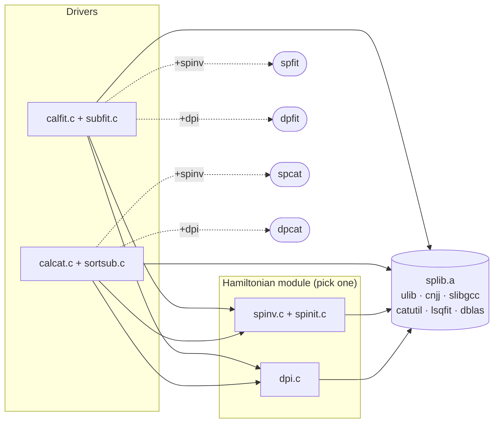
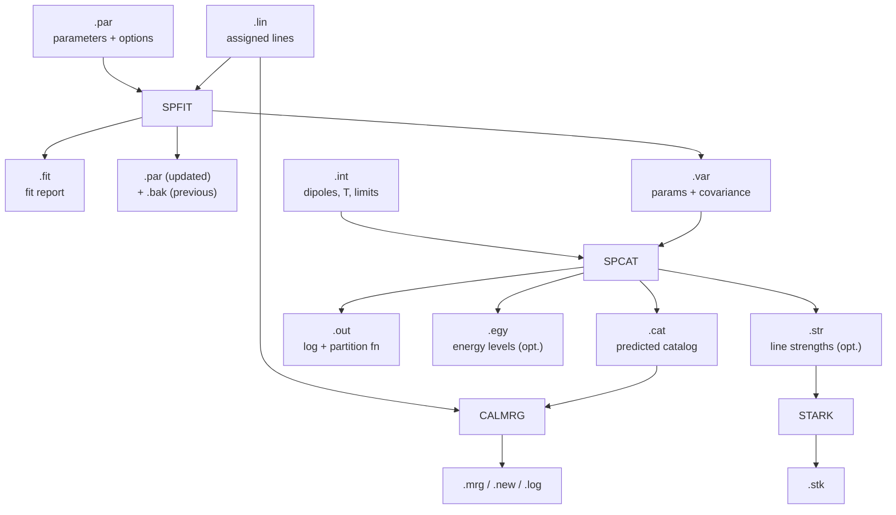

# Pickett CALPGM Suite: Developer & User Documentation

This repository holds the C source for **Herbert M. Pickett's CALPGM program suite**, best known for **SPFIT** (fitting) and **SPCAT** (prediction/catalog generation). Spectroscopists use these programs to fit and simulate rotational, ro-vibrational and hyperfine spectra of molecules. The programs come from JPL, and the CDMS (Cologne) and JPL molecular spectroscopy catalogs are built with them.

This document covers how the code is organised, how to build and run it, the main file formats, and what this fork changes. The authoritative physics and input-format reference is still the set of PDF manuals that ship with the code (see [References](#references)).

A user manual in Thai, with a step-by-step quick start and troubleshooting, is in [MANUAL_TH.md](MANUAL_TH.md).

---

## Contents

1. [Provenance](#provenance)
2. [Repository layout](#repository-layout)
3. [Architecture](#architecture)
4. [Building](#building)
5. [Running the programs](#running-the-programs)
6. [File formats (summary)](#file-formats-summary)
7. [Fork modification: extended partition function](#fork-modification-extended-partition-function)
8. [Test case and verification](#test-case-and-verification)
9. [Auxiliary programs](#auxiliary-programs)
10. [Rust file library: pickett-io](#rust-file-library-pickett-io)
11. [Rust in-process runner: pickett-sys](#rust-in-process-runner-pickett-sys)
12. [Legacy, alternate and unused files](#legacy-alternate-and-unused-files)
13. [Known issues and caveats](#known-issues-and-caveats)
14. [References](#references)

---

## Provenance

| Period | Who | What |
|---|---|---|
| 1989 | H. M. Pickett (JPL / Caltech, NASA contract NAS7-918) | Original Fortran programs |
| 22 Mar 1999 to 2008 | H. M. Pickett | Rewritten in C; the full changelog is in [`whats.new`](whats.new) |
| ~2008 | H. S. P. Müller (CDMS, Cologne) | Distributed as `Pickett_neu.zip` from the [CDMS Pickett page](https://cdms.astro.uni-koeln.de/classic/predictions/pickett/quelle/), the base of this repo |
| Oct 2020 | Kelvin Lee | Git import; SPCAT partition function now covers 1–1000 K in 1 K steps; test case added |

Git history:

```
f5af2ff Added test files and fixed bug with partition function calc
4066625 Added partition function range and gitignore   (also removed committed *.o)
e2a6f56 First commit based on HSPM's code from 2008
9352e8c first commit
```

---

## Repository layout

### Main programs (drivers)

| File | Program(s) | Role |
|---|---|---|
| [calfit.c](calfit.c) | `spfit`, `dpfit` | General non-linear least-squares line fitter (trust-region Marquardt–Levenberg) |
| [subfit.c](subfit.c) | (linked with calfit) | Helpers for the fitter: parameter labels (`getlbl`), block lookup, `.par`→`.bak` backup (`filbak`), correlation printout |
| [calcat.c](calcat.c) | `spcat`, `dpcat` | General frequency/intensity calculator; writes the `.cat` catalog and the partition function |
| [sortsub.c](sortsub.c) | (linked with calcat, sortn) | External merge/heap sort used to sort the `.cat` file at the end of SPCAT |
| [calmrg.c](calmrg.c) | `calmrg` | Merges a calculated `.cat` with experimental `.lin` lines |
| [calcatm.c](calcatm.c), [calfitm.c](calfitm.c) | `spcat`/`dpcat`, `spfit`/`dpfit` | Two-line `main()`s that call `calcat_run()` / `calfit_run()` |
| [pickett.h](pickett.h) | (library) | Public C entry points: `calcat_run`, `calfit_run`, `pk_library_mode`, `pk_fail` (see [Library entry points](#library-entry-points-picketth)) |
| [pkselftest.c](pkselftest.c) | `pkselftest_sp`, `pkselftest_dp` | Test driver that runs the library twice in one process (see [Regression tests](#regression-tests)) |

### Hamiltonian modules (one is linked into each fitter/calculator)

| File | Used by | Physics |
|---|---|---|
| [spinv.c](spinv.c) + [spinit.c](spinit.c), [spinit.h](spinit.h) | `spfit`, `spcat` | Asymmetric/symmetric rotors and linear molecules with up to ~999 vibrational states and multiple spins, l-doubling, n-fold symmetric tops, Euler/Fourier series, Itot spin basis. `spinit.c` handles the spin eigenfunctions for sets of equivalent spins. |
| [dpi.c](dpi.c) | `dpfit`, `dpcat` | Doublet-Π (²Π) states with one nuclear spin |

### Shared library (`splib.a`)

| File | Contents |
|---|---|
| [ulib.c](ulib.c) | Generic utilities: diagonaliser (`hdiag`, `triag`), eigenvector ordering (`ordblk`), `.par`/`.var` I/O (`getpar`, `getvar`, `putvar`), `.lin` reading (`getlin`), BCD parameter-ID handling, error propagation (`calerr`) |
| [cnjj.c](cnjj.c), [cnjj.h](cnjj.h) | 3j, 6j and 9j angular-momentum coupling coefficients (log-factorial tables) |
| [slibgcc.c](slibgcc.c), [slib.h](slib.h) | System-dependent code: command-line/interactive file-name handling (`filget`), `fopenq`, memory sizing, time stamps |
| [catutil.c](catutil.c), [catutil.h](catutil.h) | Quantum-number parsing (`readqn`), `pcard` free-format numeric parsing, catalog-format helpers |
| [lsqfit.c](lsqfit.c), [lsqfit.h](lsqfit.h) | Least-squares kernel (Givens rotations, Marquardt step, rank-deficient handling) |
| [dblas.c](dblas.c), [cblas.h](cblas.h) | Small bundled subset of CBLAS (`cblas_ddot`, `daxpy`, `drot`, …). It can be replaced by ATLAS or a system BLAS. |

### Documentation and data

| File | Contents |
|---|---|
| [calpgm.pdf](calpgm.pdf) | Suite overview, trust-region fitting notes, installation notes |
| [spinv.pdf](spinv.pdf) | **Main reference** for SPFIT/SPCAT: quantum-number formats, `.lin`, `.par/.var`, `.int`, `.cat`, `.str`, `.egy` formats, operator and parameter IDs, special cases |
| [dpi.pdf](dpi.pdf) | Reference for DPFIT/DPCAT parameters |
| [whats.new](whats.new) | Upstream changelog, 1999–2007 |
| [test/](test/) | CH₃CN prolate symmetric-top reference case (see [below](#test-case-and-verification)), plus the golden-output regression suite in `test/golden/` and its runner `test/run_golden.py` (see [Regression tests](#regression-tests)) |
| [README.md](README.md) | Short project description |

---

## Architecture

The suite follows a **driver + plug-in Hamiltonian** design. The generic drivers (`calfit.c`, `calcat.c`) know nothing about molecular physics. They call a fixed set of functions declared in [calpgm.h](calpgm.h) under "SPINV or DPI interface". At link time you pick `spinv.o + spinit.o` or `dpi.o` to supply those functions.



### The Hamiltonian interface (`calpgm.h`)

| Function | Purpose |
|---|---|
| `setopt` | Read the option line(s) of the `.par`/`.var` file (spins, vibrational states, K range, symmetry, DIAG, …) |
| `setfmt` | Pick the quantum-number format code (`IQNFMT`/`QNFMT`) |
| `setblk` | Set up Hamiltonian blocks from the parameter list; also releases storage when called with `npar = 0` |
| `hamx` | Build and diagonalise one Hamiltonian block. Returns energies, eigenvectors, derivatives dE/dp and mixing coefficients. |
| `getqn` | Return the quantum numbers and degeneracy for a state (block, index) |
| `setint` | Read dipole definitions from the `.int` file |
| `intens` | Compute transition dipole matrix elements between two blocks |

Parameter and dipole identifiers are stored internally as packed **BCD** (`bcd_t`, see `getbcd`/`putbcd` in `ulib.c`). This lets IDs hold more digits than a `long` can, for example for `nvib > 99`.

### Library entry points (`pickett.h`)

The programs can be called as functions, so other code can run them in its own process. The command-line programs are two-line `main()`s in `calcatm.c` / `calfitm.c`.

| Function | Purpose |
|---|---|
| `int calcat_run(int argc, char *argv[])` | SPCAT, or DPCAT when linked with `dpi.c`. The arguments are the same as on the command line. Returns 0 or a failure status. |
| `int calfit_run(int argc, char *argv[])` | SPFIT, or DPFIT when linked with `dpi.c`. |
| `void pk_library_mode(int on)` | `on != 0`: don't install the Ctrl-C (SIGINT) handler, so the host program keeps its own. |
| `void pk_fail(int code)` | Used inside the library in place of `exit(EXIT_FAILURE)`. |

How a fatal error is handled:
1. Every `exit(EXIT_FAILURE)` in the library sources is now `pk_fail()`. This covers `calcat.c`, `calfit.c`, `subfit.c`, `spinv.c`, `spinit.c`, `dpi.c`, and `fopenq()`/`mallocq()` in `slibgcc.c`.
2. Each run function sets a `setjmp` point. `pk_fail()` jumps back to it, and the run function returns the status instead of ending the process. The error message is still printed on stdout.
3. Files opened with `fopenq()` are tracked: `calpgm.h` maps `fclose` to `pk_fclose`. When a run ends, successfully or not, the files that are still open get closed.

State that would leak from one run into the next is reset at the start of each SPCAT run:
- `qsum` (the partition-function sums)
- the `ibufof()` scratch-buffer state

SPFIT's `lbufof()` already resets itself. `python test/run_golden.py --inprocess` checks this (see [Regression tests](#regression-tests)).

Limits of this layer, to be removed in later phases:
- **Not thread-safe.** The code keeps state in static variables, so only one run can be active in a process at a time.
- **Memory leaks on failure.** If a run fails in the middle of a calculation, the memory it allocated is not freed.
- **Files and stdout only.** Input and output still go through files, and progress is printed on stdout.

### Data flow



---

## Building

### With `make` (Linux/macOS/MSYS2, or `mingw32-make` on Windows)

The active makefile is [Makefile](Makefile) (gcc, `-g -O3 -Wall`):

```sh
make            # spfit spcat calmrg dpfit dpcat calbak
make all        # also iamcalc moiam stark termval sortn reassign sortegy iambak
make selftest   # pkselftest_sp, pkselftest_dp (in-process test drivers)
make install    # moves the default executables to /usr/local/bin
make clean      # removes executables, *.o and splib.a
```

`make all` was tested with `mingw32-make` and MinGW gcc 6.3 on Windows 11, and all 14 programs build. Add `CFLAGS="-O2 -w"` on the command line to hide the legacy-C warnings.

BLAS selection (edit `BLASLIB` at the top of the Makefile):

| Setting | Effect |
|---|---|
| `BLASLIB=` (default) | Uses the bundled `dblas.c` |
| `BLASLIB=-lcblas -latlas` | ATLAS |
| `BLASLIB=-lcblas -lblas` | Reference Fortran BLAS + CBLAS wrappers |

The bundled `dblas.o` goes into `splib.a` only when `BLASLIB` is empty.

[Makefile.txt](Makefile.txt) is an older alternate makefile that the main `Makefile` now covers. [makefile.linux](makefile.linux) is an obsolete g77/Fortran-era makefile; see [Legacy files](#legacy-alternate-and-unused-files).

### Without `make` (e.g. Windows + MinGW gcc)

The core programs are self-contained, so plain gcc works. These commands were tested with MinGW gcc 6.3 on Windows 11:

```sh
LIB="ulib.c cnjj.c slibgcc.c catutil.c lsqfit.c dblas.c"
gcc -O2 -o spfit calfitm.c calfit.c subfit.c spinv.c spinit.c $LIB -lm
gcc -O2 -o spcat calcatm.c calcat.c sortsub.c spinv.c spinit.c $LIB -lm
gcc -O2 -o dpfit calfitm.c calfit.c subfit.c dpi.c $LIB -lm
gcc -O2 -o dpcat calcatm.c calcat.c sortsub.c dpi.c $LIB -lm
gcc -O2 -o calmrg calmrg.c $LIB -lm
```

The code is K&R/ANSI C from ~1999–2008, so a modern compiler prints many warnings (implicit `int`, old-style definitions). Add `-w` to silence them. gcc 15 and later default to C23, which rejects the old-style declarations: add `-std=gnu17`. That was tested with MSYS2's 64-bit gcc 16.2, and it is what `pickett-sys` uses.

### Memory limits

All matrices are allocated dynamically. The heap-size hints `NDHEAPF`/`NDHEAPC` in `calpgm.h` (1.2 M) and `maxmem()` in `slibgcc.c` control the working-store size.

---

## Running the programs

All programs share the file-name handling in `filget()` ([slibgcc.c](slibgcc.c)):

* **One base name** gives every file. `spcat prolate` reads `prolate.int` and `prolate.var` and writes `prolate.out`, `prolate.cat`, and so on.
* **Explicit names** override single files: any argument whose extension matches a known one replaces that file. For example, `spfit mymol other.lin` uses `other.lin` but `mymol.par`.
* **Options**: an argument starting with `-` is passed to the program as an option string.
* **No arguments**: the program prompts `Enter file name` interactively.
* **`SPECNAME`** environment variable: the extra directory searched for `*.nam` parameter-label files when they are not in the current directory. The trailing path separator is required, e.g. `export SPECNAME=/home/me/spectra/`.

| Program | Inputs | Outputs |
|---|---|---|
| `spfit` / `dpfit` | `.par`, `.lin` | `.fit`, `.par` (new), `.bak` (old `.par`), `.var` |
| `spcat` / `dpcat` | `.int`, `.var` | `.out`, `.cat` (sorted), optional `.egy`, `.str` |
| `calmrg` | `.cat`, `.lin` (+ `.opt`) | `.mrg`, `.new`, `.log` |
| `termval` | `.lin` | `.trm`, `.lgy` |
| `stark` | `.str` | `.stk` |
| `sortegy` | `.egy`, `.inp`, `.opt` | `.lgy`, `.lin`, `.log` |
| `iamcalc` | `.iam`, `.par` | `.out`, `.int`, `.bak` |
| `moiam` | `.inp` | `.iam`, `.moi`, `.xyz` |
| `sortn` | `infile [outfile]` | sorted file |
| `reassign` | `keyfile infile outfile` | reassigned line file |
| `cnvir` | `input output` | catalog file with frequencies in cm⁻¹ |

### Typical workflow

1. Write `mol.par` (title, control line, option line(s), parameters) and `mol.lin` (assigned transitions).
2. Run `spfit mol`. Inspect `mol.fit`. Iterate. SPFIT backs up the old `.par` to `.bak` each run.
3. Copy or rename `mol.var` (or `mol.par`) for SPCAT and write `mol.int` (dipoles, temperature, limits).
4. Run `spcat mol`. This produces `mol.cat`, plus the partition-function table at the end of `mol.out`.
5. Optionally run `calmrg` to merge experimental lines into the catalog.

---

## File formats (summary)

Free-format fields are parsed by `pcard()`. The definitive descriptions are in [spinv.pdf](spinv.pdf). The examples below come from [test/](test/).

### `.par` / `.var` (parameters)

```
CH3CN                                                   Mon Jul 20 17:14:58 2009   <- line 1: title
  30  254    5    0    0.0000E+000    1.0000E+003    1.0000E+000 1.0000000000      <- line 2
s  -1    1   0  100   0   1   1   1     0    1   0                                  <- line 3: options
        10099  1.489000744965263E+005 1.00000000E-035 /A-B                          <- parameters
```

* **Line 2:** `NPAR NLINE NITR NXPAR THRESH ERRTST FRAC CAL`. These are the maximum number of parameters, maximum number of lines (negative = up to 10 quanta/state), number of iterations (negative = line-assignment diagnostics), parameters to exclude for special lines, initial Marquardt–Levenberg parameter, maximum (obs−calc)/error, error scaling (negative = "convention" scaling), and IR frequency scaling.
* **Option line(s):** `CHR SPIND NVIB KNMIN KNMAX IXX IAX WTPL WTMN VSYM EWT DIAG XOPT`. `CHR` is the option-line character. A leading `s`/`a`/`l` or similar selects symmetric-top quanta. Repeating the option line defines more vibronic states.
* **Parameter lines:** `IDPAR VALUE ERROR /LABEL`. A negative `IDPAR` ties a parameter to the previous one with the ratio given as the value. In a `.var` file, the parameter block is followed by the packed correlation/covariance matrix that SPCAT uses for uncertainties.

### `.lin` (assigned lines, for SPFIT)

Fixed-format quantum numbers (`12I3`: upper quanta, then lower) followed by free-format `FREQ ERR WT`. A blend shares the same frequency. A negative error means wavenumbers (see `getlin` in `ulib.c`).

### `.int` (intensity control, for SPCAT)

```
CH3CN                                                                  <- title
1  41505    7820.3911       0    135   -11.0    -11.0    1000. 300.    <- control line
  001  3.92197                                                         <- one line per dipole: IDIP  value (Debye)
```

Control-line fields (the `dvec[]` order in `calcat.c`, defaults in brackets):

| # | Field | Meaning |
|---|---|---|
| 0 | `FLAGS` [0] | Output flags, decoded digit by digit: ≥1000 IR (cm⁻¹) units. Hundreds digit = 1 prints energies to `.out`. Tens digit ≥ 1 writes `.str`; 2 writes the dipole components separately. Units digit ≠ 0 writes `.egy`; 2/4 adds derivatives, ≥3 adds eigenvectors, ≥5 dumps the Hamiltonian. |
| 1 | `TAG` [999] | Species tag written to `.cat` |
| 2 | `QROT` [1000] | Partition function used for intensities (e.g. at 300 K) |
| 3 | `FBGN` [0] | Minimum quantum number (block) |
| 4 | `FEND` [0] | Maximum quantum number (block) |
| 5 | `STR0` [−100] | Minimum log₁₀ intensity |
| 6 | `STR1` [−100] | Minimum log₁₀ intensity × (300 GHz / ν)² |
| 7 | `FQLIM` [9999.99] | Maximum frequency (GHz, or cm⁻¹ for IR) |
| 8 | `TEMP` [300] | Temperature (K) for intensities |
| 9 | `MAXV` [−1] | Maximum vibrational state |

### `.cat` (catalog, output of SPCAT)

Standard JPL/CDMS catalog format, fixed width:

```
   18397.7830  0.0000 -5.3539 3    0.0000  3  41505 202 1 0         0 0
FREQ(F13.4) ERR(F8.4) LGINT(F8.4) DR(I2) ELO(F10.4) GUP(I3) TAG(I7) QNFMT(I4) QN'(6I2) QN"(6I2)
```

`LGINT` is log₁₀ of the integrated intensity in nm² MHz at `TEMP`. `DR` is the degrees of freedom of the rotational partition function. `ELO` is the lower-state energy in cm⁻¹. `QNFMT = Q·100 + H·10 + NQN` gives the quantum-number format. The file is sorted by frequency at the end of the run (`sortn()`).

### `.egy` (energy levels, optional)

```
     6    1          5.273508          0.000000   1.000000    3:  1 -1
BLOCK INDEX       ENERGY(cm-1)       ERROR       MIXING   DEGEN: quanta
```

### `.out` (SPCAT log)

Echoes the inputs, parameters, block structure and line count. It ends with the **partition-function table** (`TEMPERATURE - Q(SPIN-ROT.) - log Q(SPIN-ROT.)`). Q is relative to the lowest energy level found.

### `.fit` (SPFIT report)

Per-iteration obs−calc table, blend handling, parameter values and uncertainties, correlation matrix, and RMS / microwave-RMS statistics.

---

## Fork modification: extended partition function

**Commits:** `4066625`, `f5af2ff` (Kelvin Lee, Oct 2020). **File:** [calcat.c](calcat.c), near lines 55–170.

Upstream SPCAT evaluates the spin-rotation partition function at 8 fixed temperatures: 300, 225, 150, 75, 37.5, 18.75 and 9.375 K, plus the `.int` `TEMP`. This fork replaces them with a dense grid, so Q(T) can be tabulated without re-running SPCAT at each temperature:

```c
#define NTEMP 1001
#define TMAX  1000
static double temp[NTEMP], qsum[NTEMP];
...
for (i = 0; i < NTEMP; i++)
    temp[i] = (double)(TMAX - i);       /* 1000, 999, ..., 1, 0 K */
```

After the grid is built, the upstream merge logic still runs:

* If `TEMP` from the `.int` file matches a grid point (within 0.01 K), the table uses the first 1000 entries: **1000 K → 1 K**, 1 K steps. The 0 K slot is dropped.
* If `TEMP` is off-grid (e.g. 2.725 K or 1500 K), it overwrites the 0 K slot and is sorted into place. The table then has 1001 entries, and its lowest temperature is 1 K or `TEMP`, whichever is lower.

The table goes to stdout and to the end of the `.out` file, one row per temperature:

```
TEMPERATURE - Q(SPIN-ROT.) - log Q(SPIN-ROT.)
   1000.000     47744.6549    4.6789
    999.000     47672.9235    4.6783
   ...
      1.000         2.6347    0.4207
```

To change the range, edit `TMAX` and set `NTEMP = TMAX + 1`. The grid step is fixed at 1 K. Each extra temperature adds one `exp()` per energy level, so the cost grows with `NTEMP`, but it is small next to diagonalisation. **Note:** Q is only meaningful if the calculation includes all levels that are populated at the highest temperature. Make sure `FEND`, `KNMAX` and the vibrational states you include are large enough for high-T values.

The `QROT` value on the `.int` line still sets the `.cat` intensities. The tabulated Q values are diagnostic output only and are **not** fed back automatically.

---

## Test case and verification

[test/](test/) holds a CH₃CN ground-state prolate symmetric-top prediction:

| File | Role |
|---|---|
| `prolate.var` | Rotational constants (A−B, B, D_K, D_JK, D_J), symmetric-top option line |
| `prolate.int` | μ = 3.92197 D, TAG 41505, J ≤ 135, ν ≤ 1000 GHz, T = 300 K |
| `prolate.out` | Reference log, including the 1000 → 1 K Q table |
| `prolate.cat` | Reference catalog (2314 lines) |
| `prolate.egy` | Reference energy levels |

To reproduce the reference outputs:

```sh
mkdir run && cp test/prolate.int test/prolate.var run/ && cd run
../spcat prolate
diff prolate.cat ../test/prolate.cat     # expect no differences
diff prolate.egy ../test/prolate.egy     # expect no differences
diff prolate.out ../test/prolate.out     # only the timestamp line differs on Linux
```

This was checked on Windows 11 with MinGW gcc 6.3: `.cat` and `.egy` are byte-identical to the reference. `.out` differs only in the run timestamp and in Windows' three-digit exponent format (`E+005` vs `E+05`) in the echoed parameter table.

### Regression tests

[test/run_golden.py](test/run_golden.py) checks the programs against known-good outputs in [test/golden/](test/golden/). It needs Python 3.6+ (standard library only), `make` (or `mingw32-make`) and gcc. One command builds and runs every case and reports pass/fail per file:

```sh
python test/run_golden.py
```

The cases cover SPCAT and SPFIT (the prolate case above, plus an asymmetric top), DPCAT and DPFIT (a ²Π state with hyperfine), and calbak. [test/golden/README.md](test/golden/README.md) describes each case and how its inputs were made. Each case runs in a fresh temporary directory, which is kept for inspection if anything fails. The exit status is non-zero on any failure.

How files are compared:

* `.cat` and `.egy` must match exactly. Only CRLF vs LF is ignored.
* All other files are compared token by token. Timestamps are masked and Windows' 3-digit exponents (`E+005`) are treated as `E+05`. Integers must be equal. Floats must agree within `max(rtol·|x|, 1 unit in the last printed digit)`, with `rtol = 1e-6` by default.
* `.str` dipoles are compared by magnitude, because their sign follows the arbitrary eigenvector phase.

Useful options:

```sh
python test/run_golden.py -k spfit                      # only cases whose name contains "spfit"
python test/run_golden.py --no-build                    # use the executables already built
python test/run_golden.py --clean --make-arg CFLAGS=-O0 # clean rebuild with other flags
python test/run_golden.py --update -k dpfit             # accept new outputs (review the git diff!)
```

All cases pass with the default `-O3` (x87) build, and also with `-O0` and `-O2 -msse2 -mfpmath=sse` builds (MinGW gcc 6.3, Windows 11). The SSE build changes the fitted constants by about 1e-10 relative, which is well inside the tolerance. Any change to the C code should keep `python test/run_golden.py` passing.

**In-process mode.** `--inprocess` checks the library entry points instead of the executables:

```sh
python test/run_golden.py --inprocess
```

SPCAT, SPFIT, DPCAT and DPFIT steps then run through `pkselftest_sp` / `pkselftest_dp` (built with `make selftest`). In one process, the driver:
1. calls the run function on a missing file and checks that it returns a failure status, not an exit;
2. runs the case;
3. restores the input files;
4. runs the case again.

The outputs compared are those of the second run, so state left over from the first run, or from the failure, shows up as a difference. The check is known to work: with the `qsum` reset in `calcat.c` removed, the second SPCAT run reports the partition function doubled and `prolate.out` fails.

---

## Auxiliary programs

| Program | Source | Purpose |
|---|---|---|
| `calmrg` | [calmrg.c](calmrg.c) | Merges `.cat` predictions with experimental `.lin` data. Replaces calculated frequencies with measured ones and writes `.mrg`, plus `.new`/`.log` for unmatched or bad lines. |
| `calbak` | [calbak.c](calbak.c) | Converts catalog-format lines back into a `.lin` file for SPFIT |
| `termval` | [termval.c](termval.c) | Derives term values (energy levels) from a network of assigned lines (`.lin` → `.trm`, `.lgy`) |
| `stark` | [stark.c](stark.c) | Computes Stark coefficients from the `.str` line-strength file → `.stk` |
| `sortn` | [sortn.c](sortn.c) + [sortsub.c](sortsub.c) | Sorts catalog-format files by frequency |
| `sortegy` | [sortegy.c](sortegy.c) | Sorts and relabels `.egy` energy files using rules in `.inp`/`.opt` |
| `reassign` | [reassign.c](reassign.c) | Rewrites quantum-number assignments in a line file according to a key file |
| `iamcalc` | [iamcalc.c](iamcalc.c) + [ftran.c](ftran.c), [readopt.c](readopt.c) | Internal-axis-method (IAM) internal-rotation calculations; generates `.par`/`.int` input for SPFIT/SPCAT |
| `iambak` | [iambak.c](iambak.c) | Converts IAM fit parameters back to `.iam` input |
| `moiam` | [moiam.c](moiam.c) + [ftran.c](ftran.c) | Internal-rotation structural parameters (moments of inertia) from geometry |
| `cnvir` | [cnvir.c](cnvir.c) | Converts catalog-format frequency and error fields from MHz to cm⁻¹ |
| `hundscvt` | [hundscvt.c](hundscvt.c) | Converts quantum-number labels between Hund's case (a) and (b) |

The JPL catalog-access utilities ([catread.c](catread.c), [catread.h](catread.h), [catlist.c](catlist.c), [catform.c](catform.c)) read the JPL catalog directory structure. `catform.c` is a CGI web-form handler. They use old K&R C and `gets()`, and none of the makefiles builds them.

---

## Rust file library: pickett-io

[rust/pickett-io](rust/pickett-io) is a Rust crate that reads and writes the suite's files without running the programs. It has no dependencies. It is step 1 of turning the suite into a library; later steps will call the C Hamiltonian code in-process.

| Type | Files | Reader follows | Writer format |
|---|---|---|---|
| `ParFile` | `.par`, `.var`, `.bak` | `calfit.c` line 2, `setopt()` option lines, `getpar()`, `getvar()` | SPFIT (`calfit.c`, `putvar()`) |
| `LinFile` | `.lin` | `getlin()` | `calbak.c` |
| `IntFile` | `.int` | `calcat.c` | plain, lossless (no C program writes `.int`) |
| `CatFile` | `.cat` (also `.mrg`) | fixed JPL/CDMS columns, `readqn()` | SPCAT (`calcat.c`, `gupfmt()`) |
| `EgyFile` | `.egy` | `calcat.c` level lines; other lines kept as text | SPCAT |

The building blocks are public too:
- `pcard::pcard` is the C free-format number reader. Numbers can run together (`0.31-0.07`), `,,` skips a field and `/` ends the line.
- `ParamId` holds BCD parameter and dipole IDs as digit strings, so long IDs are not truncated.
- `qn` encodes the two-character quantum fields (`A0` = 100, `a1` = −11).
- `cfmt` gives C `printf` formats with a selectable `%E` exponent width.

```sh
cd rust
cargo test                                   # unit tests + golden round trips
cargo run --example cat_summary -- ../test/golden/spcat_prolate/expected/prolate.cat
cargo run --example roundtrip -- ../test/golden/spfit_asym/expected/asym.var
cargo doc --open                             # API documentation
```

```rust
use pickett_io::{CatFile, Flavor, ParFile};

let var = ParFile::parse(&std::fs::read_to_string("mol.var")?, Flavor::Spinv)?;
for p in &var.params {
    println!("{} {} ± {:?} {}", p.id, p.value, p.error, p.label);
}
let cov = var.covariance();          // packed upper triangle, as SPFIT writes it
let cat = CatFile::parse(&std::fs::read_to_string("mol.cat")?)?;
```

Points to know:
- **Option lines depend on the module.** Pass `Flavor::Spinv` for SPFIT/SPCAT files: option lines continue while `VSYM` is negative. Pass `Flavor::Dpi` for DPFIT/DPCAT files: there is exactly one option line.
- **Round-trip guarantee.** `tests/golden.rs` reads all 29 `.par/.var/.bak/.lin/.int/.cat/.mrg/.egy` files under `test/golden/`, writes them back and parses them again. The data must be unchanged in every case. All 25 files written by the C programs come back byte-identical. The exceptions are the 3 `.int` files and one hand-typed `.var` value, as listed in `reformatted_ok()`.
- **Exponent width.** The old Microsoft C runtime used by MinGW writes 3 exponent digits (`E+005`), while glibc writes 2. Each file type remembers what it read in `exp_digits` and writes it back the same way.
- **Number values** are the correctly rounded `f64` of the decimal text. The C reader builds numbers digit by digit, so in rare cases it can differ by one unit in the last place.
- **Not covered yet:** `.str`, `.fit`, `.out`, and files with more than 6 quanta per state in `.cat`. `LinFile::parse_with_nqn` does handle wider `.lin` files.

---

## Rust in-process runner: pickett-sys

[rust/pickett-sys](rust/pickett-sys) compiles the C code and links it into Rust, so SPCAT, SPFIT, DPCAT and DPFIT run inside the calling process (see [Library entry points](#library-entry-points-picketth)).

```rust
use pickett_sys::{run_in, Program};

// reads data/mol.int and data/mol.var, writes data/mol.cat, .out, ...
run_in(Program::Spcat, std::path::Path::new("data"), "mol")?;
// then read the results with pickett-io
let cat = pickett_io::CatFile::parse(&std::fs::read_to_string("data/mol.cat")?)?;
```

| Item | Notes |
|---|---|
| `run(program, args)` | Same arguments as the command line, e.g. `["mol"]` |
| `run_in(program, dir, base)` | Passes every `<dir>/<base>.<ext>` explicitly, so directory names with dots are safe |
| `RunError::Failed { program, status }` | A fatal error in the C code. The process keeps running, and the message is on stdout |
| `ffi` | The raw `extern "C"` functions |

**How it builds.** `build.rs` has no dependencies. It calls gcc and `ar` directly and puts both variants into one `libpickett.a`:
- The SPCAT/SPFIT objects get run functions `pk_spcat_run` / `pk_spfit_run`.
- The DPCAT/DPFIT objects get `pk_dpcat_run` / `pk_dpfit_run`, and every global symbol of `calcat.c`, `calfit.c`, `subfit.c` and `dpi.c` is prefixed `dp_` with `-D` (the list is `DP_RENAMES`, found with `nm`).
- Everything is compiled with `-std=gnu17`.

**Compiler.** The build uses the first of these whose `gcc -dumpmachine` matches the target architecture: `PICKETT_CC`, `CC`, `C:\msys64\mingw64\bin\gcc.exe` (Windows), `gcc`. On Windows the Rust target must be `x86_64-pc-windows-gnu`, and the 32-bit MinGW gcc cannot be used for it. Install a 64-bit one with MSYS2:

```sh
pacman -S mingw-w64-x86_64-gcc
```

This was tested with gcc 16.2 (MSYS2) and Rust 1.100 on Windows 11. Linking works with Rust's own MinGW linker.

**Concurrency.** Calls are serialized with a global mutex, because the C code is not reentrant. Calling from several threads is safe, but the runs happen one after another.

**Tests** (`cargo test -p pickett-sys`):
- Every SPCAT/SPFIT/DPCAT/DPFIT golden case runs twice in-process. `.cat`/`.egy` must match exactly, and `.par`/`.var`/`.bak` must match within `1e-6` relative. The 64-bit build fits A = 60778.54915641392 MHz against the golden 60778.54915641401.
- A failing run returns `Err`, and the next run still works.
- Three threads run at once.
- A directory name with dots works.
- Deliberately corrupted expected files make the test fail, so the comparison is known to work.

---

## Legacy, alternate and unused files

| File | Status |
|---|---|
| [spinv0.c](spinv0.c) | Older SPINV (last revision 12 Dec 2005). [spinv.c](spinv.c) is the current one (adds the 10 Sept 2006 phase conventions). Not built. |
| [calfitno.c](calfitno.c) | Older variant of `calfit.c` (pre-2001 iteration control). Not built. |
| [dpix.c](dpix.c) | Variant of `dpi.c` with a different matrix-element pair table. Not built. |
| [slibgen.c](slibgen.c) | Generic (non-gcc) version of the system library. `slibgcc.c` is the one used. |
| [blas.c](blas.c), [blas.h](blas.h) | Pre-CBLAS BLAS subset. Replaced by `dblas.c`/`cblas.h`. |
| [jelim.c](jelim.c), [util.c](util.c), [fdate.c](fdate.c), [testi.c](testi.c) | Small helpers and tests. `testi.c` prints C type sizes. Not built. |
| [makefile.linux](makefile.linux) | Obsolete g77 makefile that refers to Fortran sources not present here (`calbak.f`, `cnvwn.f`, `slib.for`). |
| `splib.a` | Build output (the static library built from the shared sources). It used to be committed as a pre-built binary and is now git-ignored. |

---

## Known issues and caveats

1. **Partition-function grid edge case.** If the `.int` `TEMP` is exactly 0, the 0 K grid point remains and causes a division by zero. `TEMP = 0` is not physically valid for SPCAT anyway.
2. **Legacy C.** K&R definitions, `gets()` in the catalog utilities, and implicit `int main()` all trigger warnings. gcc 15+ (C23 by default) needs `-std=gnu17`.
3. **The PDF manuals' text layer is font-mangled** (ligatures and Greek letters encoded oddly). Read them in a PDF viewer rather than extracting the text.
4. **Library limits.** The run functions are not thread-safe, and memory is not freed after a failure in the middle of a calculation (see [Library entry points](#library-entry-points-picketth)).

### Fixed build issues

These were present in the 2008/2020 code and have been fixed:

| Issue | Fix |
|---|---|
| `iamcalc.c` included the missing `ftran.h` | Added [ftran.h](ftran.h) with the `ftran()` prototype |
| `iamcalc` link rule left out `readopt.o`; `iambak`, `reassign` and `sortegy` were missing | Added them to the [Makefile](Makefile) and to `make all` |
| `cnvwn` target pointed to a non-existent `cnvwn.c`, and the `calbak` rule was defined twice | Removed the dead target and the duplicate rule |
| `ifndef ($(BLASLIB))` always linked the bundled BLAS | Replaced it with `ifeq ($(strip $(BLASLIB)),)` |
| `calmrg.c` defined its own `unlink()`, which clashes with the C library on MinGW/Windows | Renamed it to `exptunlink()` (file-local) |
| Pre-built `splib.a` was committed, and `.gitignore` only covered `*.o` | Stopped tracking `splib.a`; `.gitignore` now covers `*.a`, `*.exe` and the built programs; added `make clean` |

---

## References

* H. M. Pickett, "The Fitting and Prediction of Vibration-Rotation Spectra with Spin Interactions," *J. Mol. Spectrosc.* **148**, 371–377 (1991).
* H. M. Pickett, "Spin eigenfunctions and operators for the Dn groups," *J. Mol. Spectrosc.* **228**, 659–663 (2004). (Itot basis)
* H. M. Pickett, "Use of Euler series to fit spectra with application to water," *J. Mol. Spectrosc.* **233**, 174–179 (2005).
* J. E. Dennis & R. B. Schnabel, *Numerical Methods for Unconstrained Optimization and Nonlinear Equations*, Prentice-Hall (1983). (Trust-region Marquardt)
* Bundled manuals: [calpgm.pdf](calpgm.pdf), [spinv.pdf](spinv.pdf), [dpi.pdf](dpi.pdf)
* Thai user manual: [MANUAL_TH.md](MANUAL_TH.md)
* CDMS Pickett program page: <https://cdms.astro.uni-koeln.de/classic/predictions/pickett/quelle/>
